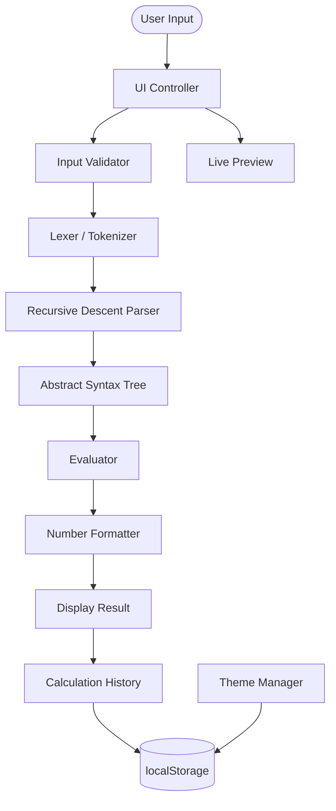

# 🧮 Minject Calculator — Web-Based Expression Calculator

<p align="center">
  
</p>

<p align="center">
  <strong>A lightweight web calculator that evaluates mathematical expressions using a custom lexer, parser, and evaluator.</strong>
</p>

<p align="center">
  
  
  
  
  
</p>

---

## 📖 About The Project

**Minject Calculator** is a lightweight web-based calculator designed to evaluate mathematical expressions beyond basic arithmetic operations.

Built with **Vanilla JavaScript, HTML, and CSS**, this project uses a custom expression-processing engine consisting of a lexer, recursive descent parser, Abstract Syntax Tree (AST), and evaluator.

Unlike calculators that rely on JavaScript's `eval()`, Minject Calculator processes expressions through its own evaluation pipeline.

The application also provides a clean interface with live calculation preview, calculation history, keyboard shortcuts, and dark/light mode.

### ✨ What Makes It Interesting?

- 🧮 Mathematical expression evaluation with operator precedence.
- 🌳 Custom parser using Recursive Descent and AST.
- ⚡ Live calculation preview while entering expressions.
- 🌓 Dark and light theme with persistent preferences.
- 📚 Calculation history stored in `localStorage`.
- ⌨️ Keyboard input and shortcut support.
- 🔢 Number formatting with up to 10 significant digits.
- 📱 Responsive layout for different screen sizes.
- 🧪 Unit tests using Jest.

---

## 🎬 How It Works

Minject Calculator processes an expression through several stages before displaying the result.



### Expression Processing Pipeline

| Stage | Description |
|---|---|
| **Input Validation** | Checks whether a character can be added to the current expression |
| **Lexer** | Converts the expression into tokens |
| **Parser** | Analyzes token structure and operator precedence |
| **AST** | Represents the expression as a tree of operations |
| **Evaluator** | Traverses the AST and calculates the result |
| **Formatter** | Formats the numeric result for display |
| **UI Controller** | Updates the expression display, preview, and calculation history |

This design separates mathematical logic from the user interface, making the calculation engine easier to maintain and test.

---

## ✨ Features

| Feature | Description |
|---|---|
| ➕ Basic Arithmetic | Addition, subtraction, multiplication, and division |
| 🧮 Operator Precedence | Evaluates operations according to mathematical precedence |
| 🔢 Parentheses | Supports regular and nested parentheses |
| ⚡ Exponentiation | Supports power operations with right-associative evaluation |
| √ Square Root | Calculates square roots |
| ➖ Negative Numbers | Supports unary minus and negative values |
| 🔗 Implicit Multiplication | Supports expressions such as `2(3+4)` |
| 👁️ Live Preview | Displays a preview when the current expression can be evaluated |
| 📚 Calculation History | Stores up to 50 recent calculations |
| 🌓 Theme Switcher | Switches between dark and light mode |
| ⌨️ Keyboard Support | Accepts keyboard input and shortcuts |
| 📌 Previous Answer | Reuses the previous calculation through the `Ans` button |
| 🧪 Error Handling | Handles invalid expressions and mathematical errors |

---

## 🔢 Supported Mathematical Operations

Minject Calculator supports the following expressions:

| Operation | Example | Result |
|---|---|---:|
| Addition | `7 + 5` | `12` |
| Subtraction | `9 - 15` | `-6` |
| Multiplication | `6 × 7` | `42` |
| Division | `20 ÷ 8` | `2.5` |
| Operator Precedence | `2 + 3 × 4` | `14` |
| Parentheses | `(2 + 3) × 4` | `20` |
| Nested Parentheses | `((1+2) × (3+4))` | `21` |
| Exponentiation | `2 ^ 10` | `1024` |
| Right-Associative Power | `2 ^ 3 ^ 2` | `512` |
| Square Root | `√16` | `4` |
| Negative Number | `-5 + 3` | `-2` |
| Implicit Multiplication | `2(3+4)` | `14` |

### Expression Handling

The parser supports:

- Standard mathematical operator precedence.
- Nested parentheses.
- Right-associative exponentiation.
- Unary negative numbers.
- Square root as a unary operator.
- Implicit multiplication between a number and a parenthesized expression, such as `2(3+4)`.
- Implicit multiplication between adjacent parenthesized expressions, such as `(2+3)(4+5)`.

---

## 🖥️ User Interface

The application uses a clean calculator layout with two main sections.

### 1. Calculator Panel

The main panel includes:

- Expression display.
- Calculation result.
- Live preview indicator.
- Numeric keypad.
- Mathematical operators.
- Clear and backspace buttons.
- `Ans` button.

### 2. Side Panel

The side panel provides additional functionality:

- **Calculation History:** Shows recent calculations and allows users to reuse a result.
- **Keyboard Shortcuts:** Displays available keyboard controls.
- **Sample Expressions:** Provides example expressions to explore calculator functionality.

### 3. Responsive Design

The interface uses CSS Grid and responsive media queries.

- Desktop: Calculator and side panel appear in a two-column layout.
- Smaller screens: Panels are arranged vertically.
- Mobile: Controls and sample expressions adapt to a narrower screen.

---

## ⌨️ Keyboard Controls

The calculator supports keyboard input without requiring every operation to be selected from the keypad.

| Key | Function |
|---|---|
| `0–9` | Enter numbers |
| `.` | Enter decimal point |
| `+` | Addition |
| `-` | Subtraction or unary negative |
| `*` or `x` | Multiplication |
| `/` | Division |
| `^` | Exponentiation |
| `(` and `)` | Parentheses |
| `r` | Square root (`√`) |
| `Enter` or `=` | Calculate expression |
| `Backspace` | Delete one character |
| `Escape` | Clear the expression |

### Keypad Controls

| Button | Function |
|---|---|
| `C` | Clear the current expression |
| `Hapus` | Delete the last character |
| `Ans` | Insert the previous answer |
| `=` | Calculate the expression |
| Theme buttons | Switch between light and dark mode |
| `Hapus riwayat` | Clear calculation history |

---

## 📚 Calculation History

The history manager stores completed calculations using browser `localStorage`.

### History Behavior

- Stores a maximum of **50 entries**.
- Newest calculations appear first.
- Each entry contains the original expression and its result.
- Clicking a history item inserts its **result** into the current expression.
- Users can clear all history.

The history manager uses the following storage key:

```text
calc_history
```

The history is managed separately from the calculator's mathematical processing logic.

---

## 🌓 Dark & Light Mode

Minject Calculator supports two interface themes.

| Theme | Description |
|---|---|
| ☀️ Light Mode | Light interface with neutral backgrounds and green accents |
| 🌙 Dark Mode | Dark interface with muted green and neutral colors |

Theme preferences are stored in browser `localStorage`, using:

```text
calc_theme
```

When no saved preference exists, the application checks the operating system preference through `prefers-color-scheme`.

---

## 🛡️ Error Handling

The calculation engine includes error handling for invalid mathematical expressions.

| Error Case | Description |
|---|---|
| Division by zero | Prevents division by zero |
| Negative square root | Rejects square roots of negative numbers |
| Empty expression | Handles empty calculation input |
| Incomplete expression | Detects expressions that cannot be parsed |
| Unbalanced parentheses | Detects missing or unexpected parentheses |
| Unknown character | Rejects unrecognized characters |
| Invalid operator placement | Prevents certain invalid consecutive operators during input |

The application uses a custom `CalcError` class to represent calculation-related errors.

---

## 🔧 Number Formatting

The result formatter is implemented in `src/utils/format.js`.

Formatting rules include:

| Rule | Behavior |
|---|---|
| Significant Digits | Up to 10 significant digits |
| Trailing Zeros | Removes unnecessary trailing zeros |
| Floating-Point Rounding | Suppresses common floating-point artifacts, such as `0.1 + 0.2` |
| Large Numbers | Uses exponential notation for absolute values of `10^15` or greater |
| Small Numbers | Uses exponential notation for non-zero absolute values below `10^-7` |

Examples:

```text
0.1 + 0.2   → 0.3
Math.PI     → 3.141592654
1.23e18     → Exponential notation
```

---

## 🧠 Core Architecture

The project separates calculation logic, interface management, and utility functions into different modules.

### Calculation Engine

| Module | Responsibility |
|---|---|
| `lexer.js` | Tokenizes mathematical expressions |
| `parser.js` | Parses tokens into an Abstract Syntax Tree |
| `evaluator.js` | Evaluates AST nodes |
| `calculator.js` | Combines tokenization, parsing, evaluation, and formatting |
| `index.js` | Exposes the calculation engine's public exports |

### User Interface

| Module | Responsibility |
|---|---|
| `app.js` | Connects DOM elements, keypad, keyboard, display, history, and theme |
| `history.js` | Manages calculation history |
| `inputValidator.js` | Validates characters before adding them to an expression |
| `theme.js` | Manages dark/light theme and persistence |
| `style.css` | Defines the visual appearance and responsive layout |

### Utilities

| Module | Responsibility |
|---|---|
| `format.js` | Formats calculation results |

### Important Design Decision

**The application does not use JavaScript `eval()`.**

Instead, expressions are processed through a custom pipeline:

```text
Expression
    ↓
Lexer
    ↓
Tokens
    ↓
Parser
    ↓
Abstract Syntax Tree (AST)
    ↓
Evaluator
    ↓
Formatted Result
```

This keeps expression parsing and mathematical evaluation explicit rather than executing the input as JavaScript code.

---

## 🛠️ Tech Stack

| Technology | Purpose |
|---|---|
| **HTML5** | Defines the calculator structure |
| **CSS3** | Handles styling, themes, layout, and responsive design |
| **Vanilla JavaScript** | Implements calculator logic and UI interactions |
| **JavaScript ES Modules** | Separates application logic into reusable modules |
| **Jest 29.7** | Runs unit tests |
| **localStorage** | Persists calculation history and theme preferences |
| **Google Fonts** | Provides Inter and JetBrains Mono typography |

### Dependencies

The project uses Jest as a development dependency.

```json
{
  "devDependencies": {
    "jest": "^29.7.0",
    "jest-environment-jsdom": "^29.7.0"
  }
}
```

There is no frontend framework or bundler required to run the web application.

---

## 📁 Project Structure

```text
minject-calculator/
│
├── 📄 index.html
│   └── Main HTML entry point
│
├── 📄 package.json
│   └── Project metadata and test scripts
│
├── 📄 package-lock.json
│   └── Dependency lockfile
│
├── 📄 jest.config.js
│   └── Jest configuration
│
├── 📖 README.md
│   └── Project documentation
│
├── 📁 src/
│   │
│   ├── 📁 calc/
│   │   ├── lexer.js
│   │   ├── parser.js
│   │   ├── evaluator.js
│   │   ├── calculator.js
│   │   └── index.js
│   │
│   ├── 📁 ui/
│   │   ├── app.js
│   │   ├── history.js
│   │   ├── index.js
│   │   ├── inputValidator.js
│   │   ├── style.css
│   │   └── theme.js
│   │
│   └── 📁 utils/
│       └── format.js
│
└── 📁 tests/
    │
    ├── 📁 calc/
    │   ├── calculator.test.js
    │   ├── evaluator.test.js
    │   ├── lexer.test.js
    │   └── parser.test.js
    │
    ├── 📁 ui/
    │   ├── history.test.js
    │   └── inputValidator.test.js
    │
    └── 📁 utils/
        └── format.test.js
```

---

## ⚙️ Getting Started

Follow these steps to run Minject Calculator locally.

### Prerequisites

Make sure you have:

- A modern web browser.
- Python installed if you want to use the Python HTTP server.
- Node.js and npm if you want to run the test suite.

### 1. Clone Repository

```bash
git clone https://github.com/herdiansyahdp/minject-calculator.git
```

### 2. Enter Project Directory

```bash
cd minject-calculator
```

### 3. Run the Application

Because the application uses JavaScript ES Modules, running it through a local HTTP server is recommended.

**Option A — Python HTTP Server**

```bash
python -m http.server 8080
```

Open the following address in your browser:

```text
http://localhost:8080
```

**Option B — VS Code Live Server**

1. Open the project folder in Visual Studio Code.
2. Install the Live Server extension if it is not already installed.
3. Right-click `index.html`.
4. Select **Open with Live Server**.

> **Note:** Opening `index.html` directly through `file://` may prevent ES Modules from working in some browsers. Use a local HTTP server instead.

---

## 🧪 Running Tests

The project uses **Jest 29.7** for unit testing.

Tests are organized into folders that correspond to the source modules.

### 1. Install Dependencies

```bash
npm install
```

### 2. Run Test Suite

```bash
npm test
```

### Testing Coverage

| Test Module | What It Tests |
|---|---|
| `lexer.test.js` | Tokenization of numbers, operators, and parentheses |
| `parser.test.js` | Expression parsing, operator precedence, and AST structure |
| `evaluator.test.js` | Mathematical operations and evaluation errors |
| `calculator.test.js` | Integration of the calculation pipeline |
| `history.test.js` | History storage, ordering, and 50-item limit |
| `inputValidator.test.js` | Input validation rules |
| `format.test.js` | Number precision and result formatting |

The test suite covers the main calculation engine, input validation, history management, and number formatting.

---

## 📌 Design Decisions

Several implementation decisions shape how the application works.

| Decision | Implementation |
|---|---|
| Frontend | Vanilla JavaScript |
| Module System | ES Modules |
| Expression Processing | Lexer → Parser → AST → Evaluator |
| Parsing Strategy | Recursive Descent Parser |
| Power Associativity | Right-associative |
| History Storage | Browser `localStorage` |
| History Limit | 50 entries |
| Theme Storage | Browser `localStorage` |
| Number Precision | 10 significant digits |
| Error Handling | Custom `CalcError` class |
| Expression Execution | Custom parser, without `eval()` |
| Testing | Jest |

---

## 🔭 Future Improvements

Potential improvements for future development:

- 📸 Add application screenshots and a live demonstration.
- 🧪 Expand test coverage for UI interactions.
- 📐 Improve validation for edge cases in mathematical expressions.
- 🧮 Add more mathematical functions.
- 📜 Add export and import options for calculation history.
- 🎨 Add more theme customization options.
- 🌐 Add an online demo deployment.

---

## 👨‍💻 Author

<p align="center">
  <strong>Herdiansyah Dwi Putra</strong><br>
  Informatics Engineering Student
</p>

<p align="center">
  <a href="https://github.com/herdiansyahdp">
    
  </a>
</p>

---

## ⭐ Support

Thanks for visiting this repository!

Feel free to explore the source code, learn from the implementation, and use it as inspiration for building your own calculator.

<p align="center">
  <i>Keep learning, keep building, and keep improving. 🚀</i>
</p>

<p align="center">
  
</p>
